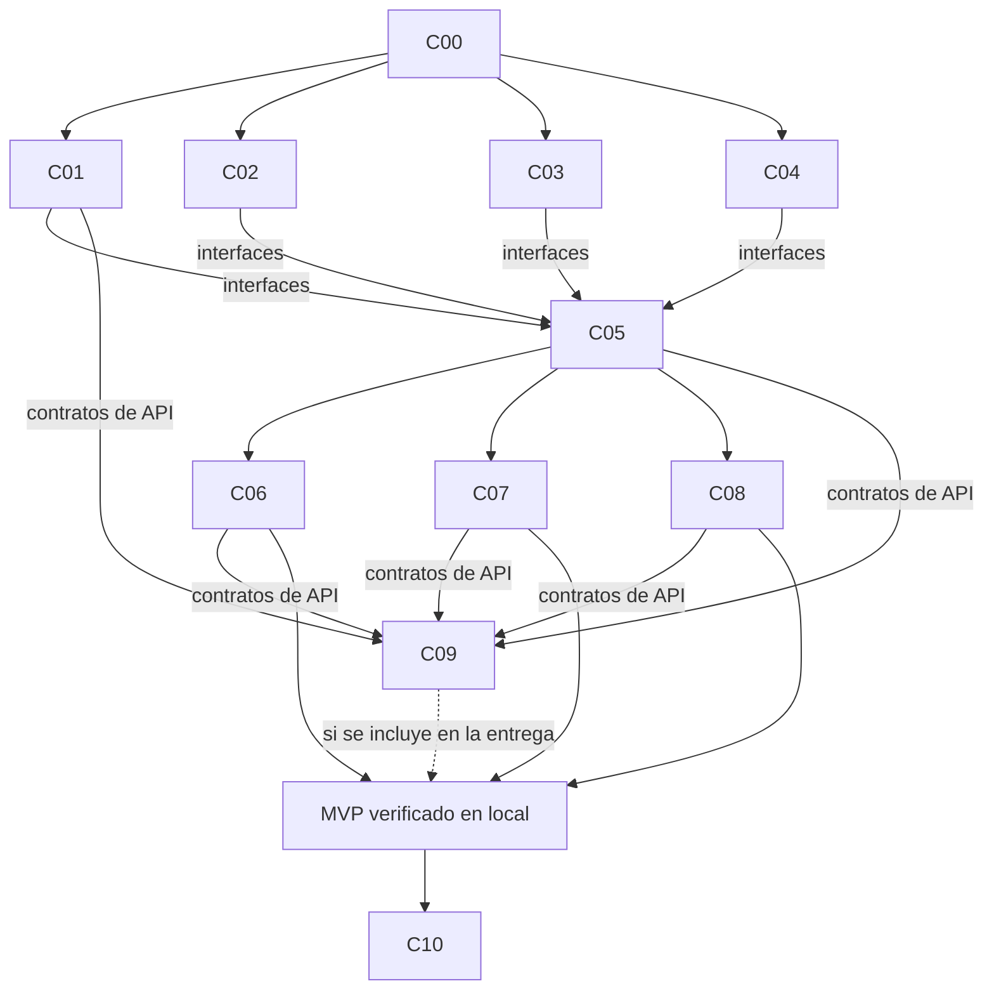

# CHANGES — Índice de roadmap de changes


> **Fuente autoritativa:** `docs/plan-ejecucion.md` (§4, §5, §6, §7, §8, §9, §12, §13). **Fecha:** 2026-11-17.
> Este archivo reemplaza al roadmap anterior (generado con el criterio viejo: un solo consultorio, monolito que servía el frontend y sin despliegue). Leer el plan de ejecución completo antes de proponer cualquier change.

## Contexto del proyecto

- **Qué es:** SaaS **multi-tenant** de gestión de turnos para consultorios odontológicos. Varios consultorios aislados entre sí (`consultorio_id` en todas las tablas de negocio, esquema compartido con PostgreSQL).
- **MVP:** agenda + turnos + registro **mínimo** de pacientes + catálogo (profesionales, sillones/boxes, prestaciones con duración) + tenancy mínimo (alta de consultorio y usuarios). **Sin historia clínica, sin cobros** (post-MVP, RN-EX-01).
- **Datos:** siempre **ficticios** — nunca datos reales de pacientes en el repo, tests, ejemplos ni capturas (Ley 25.326; plan §10).
- **Stack:** backend **Node.js con Express 5 y JavaScript** (monolito modular: módulos `consultorios`, `auth`, `catalogo`, `pacientes`, `turnos`) + **PostgreSQL 18** (Docker en local, Neon en la nube, migraciones SQL numeradas) + frontend **React 19 con Vite y JavaScript separado** (estático en Vercel; no lo sirve el backend). Despliegue final: Vercel (frontend) / Render (backend) / Neon (BD), planes gratuitos.
- **Equipo (5):** Agustina (líder), Lucia, Kevin, Lea, Gero. Ciclo OPSX por change: explore → propose → apply → verify → archive.

---

## Árbol de dependencias

```
C00  Base del proyecto (Node.js con Express 5 y JavaScript + PostgreSQL 18 en Compose + migraciones SQL + módulos por capas)
 │   [Agustina — Ola 0, bloquea todo]
 │
 ├── C01  Consultorios (tenant) y autenticación con roles ......... [Lucia]   ─┐
 ├── C02  Catálogo: profesionales y sillones/boxes ................. [Kevin]   ─┤ Ola 1:
 ├── C03  Pacientes (registro mínimo, ficticios) .................. [Lea]     ─┤ en paralelo,
 ├── C04  Prestaciones con duración variable ...................... [Gero]    ─┘ con stubs
 │
 └── C05  Crear turno SIN solapamientos por profesional Y sillón/box  [Agustina]  ← Ola 2
     │        (depende de las INTERFACES acordadas de C01–C04, no de su implementación completa)
     │        ← CHANGE PRINCIPAL DEL CICLO OPSX COMPLETO →
     │
     ├── C06  Cancelar turno y liberar el horario ......... [Lucia]   ─┐
     ├── C07  Reprogramar turno ......................... [Kevin]   ─┤ Ola 3:
     ├── C08  Consulta de agenda diaria y semanal ......... [Lea]     ─┤ en paralelo
     └── C09  Frontend mínimo React 19 con Vite (contratos de C01 y C05–C08) [Gero] ─┘
     │
     └── C10  Despliegue (Neon → Render → migraciones SQL → Vercel → CORS → humo)  [Agustina + 1]
              ← Ola 4: requiere MVP verificado en local (fase F) →
```

---

## Dependencias entre changes



## Prioridad de los seis días

Cerrar C00–C08 y la verificación del flujo de turnos antes de ampliar agenda. C09 es el primer recorte si falta tiempo. Confirmar, marcar atendido o ausente y bloquear horarios se pueden sumar tras el recorrido base, con contrato y escenarios propios. La auto-reserva queda fuera de la entrega base. Historia clínica, cobros y sucursales quedan para etapas posteriores.

## Olas

| Ola | Changes | Responsables | Arranque / sincronización |
|---|---|---|---|
| **0** | C00 | **[Agustina]** | Camino crítico: nadie arranca hasta que C00 se mergea. |
| **1** | C01, C02, C03, C04 | **[Lucia]**, **[Kevin]**, **[Lea]**, **[Gero]** | Independientes entre sí. Cada uno define su **interfaz pública en el spec**; los demás trabajan contra **stubs**. |
| **2** | C05 | **[Agustina]** | Arranca cuando las **interfaces** de la ola 1 estén acordadas — **no** hace falta esperar la implementación completa. |
| **3** | C06, C07, C08, C09 | **[Lucia]**, **[Kevin]**, **[Lea]**, **[Gero]** | C06–C08 dependen de C05; C09 depende del **contrato de API** de C01 y C05–C08. Independientes entre sí. |
| **4** | C10 | **[Agustina] + 1 integrante** | Solo con el MVP verificado en local (fase F) y la sección 9 del plan. |

*La asignación es **sugerida**: la líder la ajusta según experiencia de cada integrante (plan §7).*

---

## Puertas de paralelismo (plan §7)

1. **Ola 0 es el camino crítico:** hasta que C00 se mergea, nadie empieza.
2. **Ola 1 en paralelo con stubs:** C01–C04 son independientes; cada spec define la interfaz pública que consumen los demás (nadie espera al compañero).
3. **C05 necesita interfaces, no implementaciones:** arranca con las interfaces de ola 1 acordadas; la implementación de los otros módulos puede seguir avanzando en paralelo.
4. **Ola 3 en paralelo:** C06–C08 parten de C05. C09 puede avanzar con stubs mientras se implementan los contratos acordados con C01 y C05–C08.
5. **Archivos compartidos:** `package.json`, migraciones (`db/migrations/`) y configuración los toca **una sola persona por ola** (designada por la líder) — un dueño por archivo compartido por ola (plan §6).

---

## Path crítico (camino crítico)

**C00 → (C01 / C02 / C03 / C04) → C05 → (C06 / C07 / C08 / C09) → C10**

- **C00** es bloqueo total (ola 0).
- La **ola 1** está en el path crítico como conjunto: C05 no puede validar solapamientos reales sin los módulos que lo alimentan (aunque arranque con interfaces).
- **C05** es el change más pesado y el único con ciclo OPSX completo obligatorio (fase D) — retrasos acá retrasan toda la ola 3.
- **C10** cierra: nada se despliega hasta la verificación integral (fase F).

---

## Changes

### C00 — Base del proyecto
- **Gobernanza** · ALTA para configuración y datos, CRÍTICA para auth.
- **Leer antes** · [devops local docker](knowledge-base/11_devops_local_docker.md), [arquitectura propuesta](knowledge-base/08_arquitectura_propuesta.md).
- **Ola:** 0 · **Depende de:** nada.
- **Responsable sugerido:** Agustina.
- **Tamaño:** grande. Priorizar un arranque reproducible antes de ampliar la base.
- **Módulos y archivos:** `package.json`, árbol `src/modules/` con rutas, servicios, dominio y repositorios, `db/migrations/` con migración `001`, Docker Compose con PostgreSQL 18, `.env.example`, README y módulo `auth` mínimo.
- **Alcance:** API Express 5 en JavaScript, `DATABASE_URL`, arranque reproducible, migraciones y `npm test`. El contrato mínimo de auth es `{ usuarioId, consultorioId, rol }`. C01 completa usuarios y permisos.
- **Runner propuesto:** `node-pg-migrate` con SQL numerado, para reutilizar historial, transacciones y bloqueo. C00 verifica archivos `001_*.sql`, orden de rangos, fallo, repetición y conexión. Usar migraciones hacia adelante.
- **Riesgos:** C00 bloquea la ola 1. Si Docker falla, usar PostgreSQL 18 directo. Acordar con C01 la propiedad de cada tabla inicial.
- **Estado:** completo, archivado el 2026-11-19 en `openspec/changes/archive/` (suite en verde, 46 tests). Las tablas iniciales `consultorio` y `usuario` quedaron cerradas por DD-19; C01 las extiende en su rango 010–019.

### C01 — Consultorios (tenant) y autenticación con roles
- **Gobernanza** · CRÍTICA para autenticación y autorización.
- **Leer antes** · [actores y roles](knowledge-base/03_actores_y_roles.md), [arquitectura propuesta](knowledge-base/08_arquitectura_propuesta.md).
- **Ola:** 1 · **Depende de:** C00.
- **Responsable sugerido:** Lucia.
- **Tamaño:** mediano.
- **Módulos y archivos:** `consultorios` y `auth`, alta interna por comando o seed, usuarios y permisos por consultorio. Ampliar la base de C00 y publicar `{ usuarioId, consultorioId, rol }`.
- **Riesgos:** elegir mecanismo simple de autenticación en el spec. Separar condición profesional de administración y acordar con C02 cómo se vincula una identidad con una ficha profesional.

### C02 — Catálogo: profesionales y sillones/boxes
- **Gobernanza** · BAJA para CRUD de catálogo.
- **Leer antes** · [modelo de datos](knowledge-base/04_modelo_de_datos.md), [reglas de negocio](knowledge-base/05_reglas_de_negocio.md).
- **Ola:** 1 · **Depende de:** C00.
- **Responsable sugerido:** Kevin.
- **Tamaño:** mediano.
- **Módulos y archivos que toca:** `catalogo` (entidades `Profesional`, `SillonBox`; restricciones únicas **con `consultorio_id`**: (`consultorioId`,`nombre`), (`consultorioId`,`email`) — RN-TEN-03), migración SQL numerada de esas tablas, endpoints CRUD dentro del tenant. Interfaz pública: catálogo del consultorio (profesionales y sillones/boxes activos).
- **Riesgos:** solapamiento de archivos con C01/C03/C04 en `package.json`/migraciones/config (un dueño por ola); definir en el spec si `Profesional` se vincula a `Usuario` ODONTOLOGO (1:1 opcional) para no acoplar con C01.

### C03 — Pacientes (registro mínimo)
- **Gobernanza** · BAJA para CRUD de ficha básica.
- **Leer antes** · [actores y roles](knowledge-base/03_actores_y_roles.md), [reglas de negocio](knowledge-base/05_reglas_de_negocio.md).
- **Ola:** 1 · **Depende de:** C00.
- **Responsable sugerido:** Lea.
- **Tamaño:** chico.
- **Módulos y archivos que toca:** `pacientes` (entidad `Paciente`: nombre + al menos un contacto obligatorio — RN-PAC-01; búsqueda básica — RN-PAC-02; único compuesto con `consultorioId`), migración SQL numerada de `paciente`, endpoints de alta/búsqueda. Interfaz pública: pacientes del tenant.
- **Riesgos:** **datos siempre ficticios** (regla dura, plan §10); tentación de meter historia clínica → fuera de alcance (RN-EX-01); conflictos de migración compartida.

### C04 — Prestaciones con duración variable
- **Gobernanza** · BAJA para CRUD de prestaciones.
- **Leer antes** · [modelo de datos](knowledge-base/04_modelo_de_datos.md), [reglas de negocio](knowledge-base/05_reglas_de_negocio.md).
- **Ola:** 1 · **Depende de:** C00.
- **Responsable sugerido:** Gero.
- **Tamaño:** chico.
- **Módulos y archivos que toca:** `catalogo` (entidad `Prestacion` con `duracionMin` > 0; única compuesta (`consultorioId`,`nombre`)), migración SQL numerada de `prestacion`, endpoints CRUD. Interfaz pública: catálogo de prestaciones con duración (define `horaFin = horaInicio + duración` en C05 — RN-AG-07).
- **Riesgos:** **comparte el módulo `catalogo` con C02** → coordinar dueño de archivos dentro de la ola (los dos tocan `catalogo`; separar bien entidades/migraciones); definir en el spec la interfaz exacta que consumirá C05.

### C05 — Crear turno sin solapamientos por profesional Y sillón/box
- **Gobernanza** · MEDIA para reglas de reserva.
- **Leer antes** · [modelo de datos](knowledge-base/04_modelo_de_datos.md), [reglas de negocio](knowledge-base/05_reglas_de_negocio.md), [flujos principales](knowledge-base/07_flujos_principales.md).
- **Ola:** 2 · **Depende de:** interfaces acordadas de C01 (auth + consultorio), C02 (profesional y sillón/box), C03 (paciente), C04 (prestación/duración) — **no** de su implementación completa (plan §7).
- **Responsable sugerido:** Agustina (líder).
- **Tamaño:** grande. Empezar por el flujo de reserva y verificar la concurrencia antes de sumar ampliaciones de agenda.
- **Módulos y archivos:** `turnos` y sus migraciones SQL. Consumir las interfaces de `auth`, `consultorios`, `catalogo` y `pacientes`. Intervalos `[inicio, fin)` en UTC con `timestamptz`. Recepción y admin crean turnos. El profesional habilitado cuando no hay recepción puede hacerlo en su propia agenda.
- **Alcance:** validar reglas RN-AG-01, RN-AG-02 y RN-AG-05 a RN-AG-07. Rechazar solapamientos por profesional y box de forma transaccional, también ante solicitudes simultáneas. Evaluar restricciones de exclusión en `design.md`. Usar duración de la prestación y el consultorio autenticado.
- **Ciclo OPSX completo:** spec aprobado, implementación, `npm test`, verificación y archivo. Cubrir reserva válida, conflictos por profesional y por box, turnos contiguos, concurrencia y aislamiento entre consultorios.
- **Riesgos:** C05 puede prepararse con interfaces acordadas y stubs. Para verificar el recorrido integrado se necesitan las implementaciones reales de C01–C04.

### C06 — Cancelar turno y liberar el horario
- **Gobernanza** · MEDIA para cancelación.
- **Leer antes** · [reglas de negocio](knowledge-base/05_reglas_de_negocio.md), [flujos principales](knowledge-base/07_flujos_principales.md).
- **Ola:** 3 · **Depende de:** C05.
- **Responsable sugerido:** Lucia.
- **Tamaño:** mediano.
- **Módulos y archivos:** `turnos`. Recepción y administración registran `CANCELADO`, fecha UTC, usuario operador y origen de la solicitud. Se conserva el turno y se libera el horario. Un paciente solicita el cambio por teléfono o WhatsApp.
- **Riesgos:** coordinar el modelo de estados con C05 y separar archivos compartidos con C07 y C08. Verificar que una segunda solicitud no altere el registro de la primera cancelación.

### C07 — Reprogramar turno
- **Gobernanza** · MEDIA para reprogramación.
- **Leer antes** · [reglas de negocio](knowledge-base/05_reglas_de_negocio.md), [flujos principales](knowledge-base/07_flujos_principales.md).
- **Ola:** 3 · **Depende de:** C05.
- **Responsable sugerido:** Kevin.
- **Tamaño:** mediano.
- **Módulos y archivos que toca:** `turnos` (mover horario/fecha revalidando **todas** las reglas de solapamiento sobre el nuevo rango — RN-AG-01/02/06, transaccional), `auth` para autorizar a recepción o administración (RN-AG-03).
- **Riesgos:** misma validación que C05 pero sobre un turno existente (riesgo de duplicar lógica — reusar la interfaz de validación de C05, no copiarla); conflictos de archivo con C06/C08 en `turnos`.
- **Estado:** completo, archivado el 2026-11-23 en `openspec/changes/archive/` (suite en verde, 421 tests). La reprogramación reutiliza la validación transaccional de solapamientos de C05 (excluyendo el turno que se mueve); el spec principal `turnos` queda creado con estos requisitos y C05 agrega los suyos al archivarse.

### C08 — Consulta de agenda diaria y semanal
- **Gobernanza** · BAJA para consulta con permisos acordados.
- **Leer antes** · [actores y roles](knowledge-base/03_actores_y_roles.md), [flujos principales](knowledge-base/07_flujos_principales.md).
- **Ola:** 3 · **Depende de:** C05.
- **Responsable sugerido:** Lea.
- **Tamaño:** mediano.
- **Módulos y archivos que toca:** `turnos` (lectura de agenda por rango: día/semana, por profesional; recepción y administración ven las agendas del consultorio, cada odontólogo ve la suya — RN-AG-03), índices de lectura (`consultorio_id`, `profesional_id`, `inicio`), endpoints de consulta. **Contrato de API** que consumirá C09.
- **Riesgos:** cada consulta debe filtrar por el consultorio autenticado — test de aislamiento obligatorio; cambios de contrato después de que C09 arranque → congelar contrato en el spec.

### C09 — Frontend mínimo en React 19 con Vite y JavaScript
- **Gobernanza** · MEDIA para integración y permisos de interfaz.
- **Leer antes** · [funcionalidades](knowledge-base/06_funcionalidades.md), [arquitectura propuesta](knowledge-base/08_arquitectura_propuesta.md).
- **Ola:** 3 · **Depende de:** contrato de API de C05–C08 (y C01 para login) — **fuera del primer change** (plan §2: frontend mínimo, después del backend).
- **Responsable sugerido:** Gero.
- **Tamaño:** mediano — mínimo viable: consumir la API, no reescribir lógica de negocio en el navegador.
- **Módulos y archivos que toca:** `frontend/` (`src/features/` por funcionalidad: auth, agenda, pacientes; `src/shared/` cliente HTTP; `src/pages/`), CSS responsivo. **No toca** el backend salvo ajustes de CORS local (config) si hace falta. Validaciones de solapamiento **siempre en servidor**; el frontend solo UX.
- **Riesgos:** riesgo de scope (pantallas de más — MVP es lo mínimo para operar el flujo); consumir un contrato que aún cambia (trabajar contra el contrato congelado de los specs); CORS (en local el origen del frontend local, en nube solo su dominio).

### C10 — Despliegue (Vercel / Render / Neon)
- **Gobernanza** · ALTA para configuración de despliegue.
- **Leer antes** · [arquitectura propuesta](knowledge-base/08_arquitectura_propuesta.md), [devops local docker](knowledge-base/11_devops_local_docker.md).
- **Ola:** 4 · **Depende de:** MVP verificado en local (fase F: se puede crear consultorio, usuarios, profesionales, boxes, pacientes y turnos sin solapamientos).
- **Responsable sugerido:** Agustina + 1 integrante.
- **Tamaño:** mediano.
- **Módulos y archivos que toca:** configuración de producción y variables de entorno, `.env.example`, `.gitignore`, README (arranque en frío documentado), CI/servicio en Render, proyecto Neon, publicación en Vercel. Código de negocio: solo lo mínimo para hacerlo configurable.
- **Checklist (plan §9):**
  1. **Neon:** crear proyecto y base PostgreSQL 18; cadena de conexión **solo en variables de entorno**.
  2. **Render:** servicio web del backend (Docker o arranque Node.js); env vars (BD Neon, secreto del token, dominio permitido por CORS); endpoint de health check.
  3. **Migraciones:** aplicar las migraciones SQL con el runner sobre Neon (mismas migraciones que local).
  4. **Vercel:** publicar frontend apuntando a la URL del backend **por configuración, no hardcodeada**.
  5. **CORS:** permitir **únicamente** el dominio del frontend.
  6. **Prueba de humo en la nube** con **datos ficticios**.
  7. **Sin secretos en el repo:** `.env` en `.gitignore`, solo `.env.example` sin valores reales.
- **Antes de desplegar:** verificar en las páginas oficiales de Vercel, Render y Neon los **límites vigentes de los planes gratuitos** (cambian seguido; no asumirlos).
- **Riesgos:** arranque en frío (aceptable para validar, no para producción real — documentar en README); límites de planes gratuitos por verificar; diferencias local/nube (mitigación: PostgreSQL 18 en ambos + migraciones versionadas).

---

## Rangos reservados de migraciones

| Change | Rango | Uso |
|---|---|---|
| C00 | 001–009 | Base. La primera es 001. |
| C01 | 010–019 | Consultorios y auth. |
| C02 | 020–029 | Profesionales y sillones/boxes. |
| C03 | 030–039 | Pacientes. |
| C04 | 040–049 | Prestaciones. |
| C05 | 050–059 | Turnos y disponibilidad. |
| C06 | 060–069 | Cancelación. |
| C07 | 070–079 | Reprogramación. |
| C08 | 080–089 | Lectura de agenda. |
| C09 | 090–099 | Reservado. El frontend no requiere migraciones. |
| C10 | 100–109 | Reservado para ajustes de esquema aprobados. El despliegue aplica la secuencia existente. |

Cada responsable usa su rango y coordina archivos compartidos. Antes de integrar, verificar en una base vacía y en una base con el último esquema compartido. Cada runner candidato debe probar que detecta una versión inferior pendiente tras una superior. Si exige aplicar en orden, integrar y aplicar los rangos en orden ascendente, aunque el desarrollo siga en paralelo. Una migración mergeada se conserva. Para cambios posteriores que ya no puedan usar un rango anterior, coordinar un nuevo prefijo al final de la secuencia.

## Resumen por change

| ID | Change | Responsable | Tamaño | Ola |
|---|---|---|---|---|
| C00 | Base del proyecto | Agustina | 🔴 grande (partir si crece) | 0 |
| C01 | Consultorios y auth con roles | Lucia | mediano | 1 |
| C02 | Catálogo: profesionales y sillones/boxes | Kevin | mediano | 1 |
| C03 | Pacientes (registro mínimo) | Lea | chico | 1 |
| C04 | Prestaciones con duración variable | Gero | chico | 1 |
| C05 | Crear turno sin solapamientos (OPSX completo) | Agustina | 🔴 grande (partir si crece) | 2 |
| C06 | Cancelar turno y liberar horario | Lucia | mediano | 3 |
| C07 | Reprogramar turno | Kevin | mediano | 3 |
| C08 | Agenda diaria y semanal | Lea | mediano | 3 |
| C09 | Frontend mínimo React 19 con Vite | Gero | mediano | 3 |
| C10 | Despliegue | Agustina + 1 | mediano | 4 |

---

## Riesgos del roadmap (plan §13 + específicos)

| Riesgo | Alcance | Mitigación |
|---|---|---|
| Multi-tenant agranda el alcance y compromete el change principal (C05) | proyecto | Tenant mínimo: `consultorio_id` + aislamiento + tests; lo demás queda como etapa posterior |
| Un change bloquea a los demás | dependencias | Contratos en los specs, stubs y ola 0 corta (C00 lo más chico posible) |
| Conflictos de archivos entre 5 personas | todas las olas | Módulos separados y **un dueño por archivo compartido por ola** (`package.json`, migraciones, config) |
| Diferencias entre local y nube | C10 | PostgreSQL 18 en ambos y migraciones SQL numeradas versionadas en el repo |
| Arranque en frío de los planes gratuitos | C10 | Aceptarlo para validación; documentarlo en el README |
| Se pierde contexto entre sesiones | proyecto | Registrar decisiones en Engram y en `knowledge-base/09_decisiones_y_supuestos.md` |
| Ampliaciones de agenda pueden demorar el recorrido principal | C05–C09 | Verificar creación, consulta, reprogramación y cancelación antes de sumar estados, bloqueos o auto-reserva |
| Mecanismo concreto de autenticación | C00–C01 | Conservar interfaz estable y elegir el mecanismo simple en el spec |
| Límites de planes gratuitos de Vercel/Render/Neon por verificar | C10 | Verificar en páginas oficiales antes de desplegar (plan §9) |
| C05 grande y en el path crítico | C05 → ola 3 | Ciclo OPSX completo desde el inicio; partir el change si crece, sin bajar la exigencia de 3 escenarios |

---

## Interfaces, stubs y reglas del workflow (plan §6 y §7)

**Interfaces y stubs:**
- Cada spec de la **ola 1 (C01–C04)** define su **interfaz pública** (endpoints, DTOs, contratos de servicio). Los demás cambios programan **contra stubs** de esas interfaces sin esperar la implementación del compañero.
- **C05** arranca con las interfaces de ola 1 **acordadas** (no implementadas al 100%).
- **C09** trabaja sobre el **contrato de API** acordado de C01 y C05–C08 (los specs de ola 3 lo mantienen estable).

**Workflow en GitHub (plan §6):**
- Rama principal protegida: **solo por Pull Request con ≥ 1 aprobación**.
- Una rama por change: **`feature/<id-change>-<nombre>`** (p. ej. `feature/C05-crear-turno-sin-solapamiento`).
- Ejecutar `npm test` antes de pedir el PR de implementación y actualizar la rama desde main según el flujo del equipo.
- Commits chicos y frecuentes, cada quien con su propio usuario.
- **Archivos compartidos** (`package.json`, migraciones, configuración): **una sola persona por ola** los toca.
- Ciclo OPSX por change: **explore → propose → apply → verify → archive**; en Apply no se inventan decisiones fuera del spec — si falta algo, se vuelve a Propose.
- Ningún change sin **spec aprobado con ≥ 3 escenarios** (feliz, error de negocio, borde).

## Notas para C01 (heredado del security-review de C00)

- Emitir tokens siempre con expiración (hoy el middleware acepta tokens sin `exp`).
- Validar que `consultorioId` sea un UUID al emitir el token.
- Responder 400, no 500, ante JSON malformado en los endpoints que reciben cuerpo.
- Revisar `npm audit` (3 avisos moderados vía node-pg-migrate) sin usar `--force`.