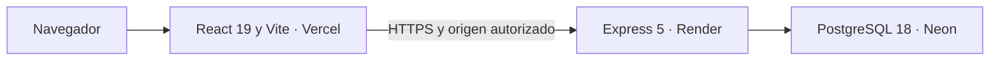

# Plan de ejecución: sistema de turnos para consultorios odontológicos (SaaS multi-tenant)

> **Para el equipo / Active Stack en Codex.** Leer este archivo completo antes de generar o ajustar la knowledge-base, `CHANGES.md` o cualquier spec.
> Actualizado con las decisiones aprobadas para la Fase 1.

---

## 0. Reglas para el agente

1. Las decisiones vigentes están en la sección 2 y en la base de conocimiento.
2. **No aprobar en automático.** Al final de cada etapa, preguntar Continuar / Ajustar / Parar acá y esperar la respuesta de la líder.
3. **No inventar.** Todo dato sin respaldo va a `knowledge-base/10_preguntas_abiertas.md` como "No evidenciado".
4. **Datos ficticios siempre.** Nunca datos reales de pacientes en el repo, en ejemplos, tests ni capturas.
5. Si este plan contradice algo ya generado (KB, roadmap), **no lo resuelvas en silencio**: avisá la contradicción y proponé Ajustar.
6. Registrar cada decisión nueva en `knowledge-base/09_decisiones_y_supuestos.md` y en Engram.

---

## 1. Estado actual del flujo

- La fundación existente incluye KB, roadmap, reglas y espacio OpenSpec inicializado. La Fase 0 verificó que correspondían al stack anterior.
- Agustina autorizó la Fase 1. Esta entrega ajusta la KB, el roadmap y el plan. Las reglas del agente y el registro de skills se coordinan en paralelo.
- Política visual `deferred`. Se revisa al llegar al change visual C09.
- La cátedra confirmó el cambio de stack y el equipo informó que probó PostgreSQL 18 con Neon.

---
## 2. Decisiones vigentes

| Tema | Antes | Ahora |
|---|---|---|
| Escala | Un solo consultorio, sin noción de tenant | **CAMBIA:** SaaS multi-tenant (varios consultorios aislados) |
| Ejecución | Local, con Docker opcional | **CAMBIA:** todo local hasta terminar el MVP; después se despliega |
| Despliegue | No definido (pregunta abierta de infraestructura) | **CAMBIA:** Vercel (frontend), Render (backend), Neon (base de datos), todos en plan gratuito |
| Arquitectura | Monolito que servía el frontend | Monolito modular por capas con frontend estático separado |
| Base de datos | PostgreSQL | PostgreSQL 18 en local y en Neon, conexión por `DATABASE_URL` |
| Backend | Stack anterior | Node.js con Express 5 y JavaScript. Pruebas con `npm test` |
| Frontend | Stack anterior | React 19 con Vite y JavaScript, mínimo en C09 |
| Alcance del MVP | Agenda + turnos con registro mínimo de paciente | Historia clínica, cobros, contabilidad y sucursales en etapas posteriores |
| Equipo | 5 integrantes, la líder conduce | Se conservan las asignaciones. La cátedra amplió el máximo a seis, según el equipo |
| Prioridad de calidad | Mantenibilidad, costo cero | Sin cambio |
| Design-system | `deferred` | Sin cambio |

---

## 3. Alineación de la base de conocimiento

La base de conocimiento documenta estas decisiones en:

- **decisiones:** registrar el paso a multi-tenant, el despliegue y la separación frontend/backend, con fecha y motivo.
- **arquitectura:** diagrama de la sección 4, tenant en cada capa y política de despliegue.
- **modelos de datos:** `consultorio_id` en todas las tablas de negocio; entidad `Consultorio` (tenant); entidades `Profesional`, `SillonBox`, `Prestacion`, `Paciente` (mínimo) y `Turno`.
- **reglas de negocio:** las de agenda (duración de prestaciones, sillones o boxes, prevención de solapamientos) **dentro de cada tenant**; aislamiento entre tenants.
- **actores:** documentar los roles aprobados (sección 5.2).
- **features:** el MVP sigue siendo agenda y turnos; sumar alta mínima de consultorio y de usuarios.
- **preguntas abiertas:** sumar las de la sección 12.

---

## 4. Arquitectura objetivo

Local: Express y PostgreSQL 18 en Compose, con el frontend Vite separado a partir de C09. PostgreSQL instalado directamente es el respaldo si falla Docker.

El backend es un monolito modular por capas con rutas HTTP, servicios, dominio y repositorios SQL. Los módulos `auth`, `consultorios`, `catalogo`, `pacientes` y `turnos` se comunican mediante interfaces públicas. El acceso a tablas queda a cargo de su módulo.

- Toda consulta de negocio lleva el filtro `consultorio_id` del contexto autenticado. La API no acepta el identificador de consultorio desde el cliente.
- `auth` devuelve `{ usuarioId, consultorioId, rol }`. C00/C01 especifican el mecanismo simple de autenticación. Los tests verifican lecturas y escrituras aisladas.
- Restricciones únicas e índices de negocio incorporan el consultorio. Guardar instantes UTC en `timestamptz` y mostrar la hora de Buenos Aires.
- Aplicar migraciones SQL numeradas desde `db/migrations/` con `DATABASE_URL`. Se propone `node-pg-migrate` para gestionar historial, transacciones y bloqueo. C00 comprueba la secuencia, repetición y comportamiento ante fallos antes de adoptarlo.

---
## 5. Roles

### 5.1 Roles del equipo (se mantienen)

| Integrante | Rol |
|---|---|
| Agustina | **Líder:** conduce la fundación y el ciclo OPSX, crea el repo, maneja la rama principal y controla los PR, define secuencia y paralelismo de los changes |
| Lucia, Kevin, Lea, Gero | Integrantes: cada uno con su rama, sus commits y sus changes asignados |

Todos tienen que tener commits propios, hablar en el video y figurar en la reflexión.

### 5.2 Roles del sistema

- `ADMIN_CONSULTORIO` equivale a dueño. Gestiona usuarios, catálogo y todas las agendas de su consultorio.
- `RECEPCION` crea, reprograma y cancela turnos y maneja la ficha básica y el contacto del paciente.
- `ODONTOLOGO` ve su agenda. Cuando se habilitan las ampliaciones, marca atendido o ausente y bloquea horarios. Puede dar turnos en su propia agenda si el consultorio funciona sin recepción y se le habilita ese permiso.
- El alta inicial de consultorios se realiza mediante seed o comando operativo.

Ser admin y ser profesional son condiciones independientes. La futura historia clínica queda accesible al odontólogo del caso inicial de un único profesional. Recepción conserva acceso administrativo a turnos y contacto. Las correcciones clínicas serán nuevos registros con fecha y autor que preservan el original. El diseño multiprofesional y los requisitos de acceso legal se revisarán antes de implementar ese módulo.

---
## 6. Flujo de trabajo en GitHub

- Rama principal protegida: no se sube directo, solo por Pull Request con **al menos 1 aprobación**.
- Una rama por change: `feature/<id-change>-<nombre>`.
- Commits chicos y frecuentes, con mensajes claros. Cada persona commitea con su propio usuario.
- Coordinar un responsable por archivo compartido (`package.json`, configuración y manifiestos). Cada change usa su rango de `db/migrations/` definido en `CHANGES.md`. Si el runner exige orden, integrar rangos en secuencia ascendente.
- Antes de pedir el PR de implementación, ejecutar `npm test` y revisar que el change cubra al menos los escenarios feliz, error de negocio y borde.

---

## 7. Plan de changes por olas

La asignación es **sugerida**: la líder la ajusta según experiencia de cada integrante. El roadmap oficial es `CHANGES.md`; esta tabla es la guía para generarlo.

| Ola | ID | Change | Depende de | Responsable sugerido |
|---|---|---|---|---|
| 0 | C00 | Base: Express 5, PostgreSQL 18 en Compose, migración 001, runner SQL, auth mínimo, módulos por capas, `.env.example` y README | nada | Agustina |
| 1 | C01 | Consultorios (tenant) y autenticación con roles | C00 | Lucia |
| 1 | C02 | Catálogo: profesionales y sillones/boxes | C00 | Kevin |
| 1 | C03 | Pacientes (registro mínimo: nombre y contacto, ficticios) | C00 | Lea |
| 1 | C04 | Prestaciones con duración variable | C00 | Gero |
| 2 | C05 | **Crear turno sin solapamientos por profesional y por sillón/box** (change del ciclo OPSX completo) | C01 a C04 | Agustina |
| 3 | C06 | Cancelar turno y liberar el horario | C05 | Lucia |
| 3 | C07 | Reprogramar turno | C05 | Kevin |
| 3 | C08 | Consulta de agenda diaria y semanal | C05 | Lea |
| 3 | C09 | Frontend mínimo en React 19 con Vite y JavaScript sobre la API | contratos de C01 y C05 a C08 | Gero |
| 4 | C10 | Despliegue (sección 9) | MVP verificado en local | Agustina + 1 integrante |

**Puertas de paralelismo:**
- Ola 0 es el camino crítico: hasta que C00 se mergea, nadie empieza.
- Ola 1: C01 a C04 son independientes entre sí. Cada uno define su **interfaz pública** en el spec y los demás trabajan contra stubs.
- C05 puede prepararse con interfaces acordadas y stubs. Su verificación integrada requiere C01–C04 implementados.
- Ola 3: C06 a C08 se desarrollan en paralelo. C09 puede trabajar con stubs una vez acordados los contratos de C01 y C05–C08.

**Prioridad de seis días.** Verificar primero el recorrido de turnos: crear, consultar, reprogramar y cancelar. El paciente se comunica con el consultorio. C09 es el primer recorte si falta tiempo. Confirmación, estados de asistencia y bloqueos se amplían después del flujo base si hay capacidad. Auto-reserva queda fuera de la entrega base.

**Cada change en `CHANGES.md` debe indicar:** dependencias, ola, módulos y archivos que toca, responsable, tamaño estimado y riesgos. Si un change es grande, partirlo.

---

## 8. Fases de ejecución y criterios de salida

| Fase | Qué se hace | Se pasa a la siguiente cuando |
|---|---|---|
| A. Ajustar fundación | Actualizar KB (sección 3). Generar `CHANGES.md` con este plan. Skills, registro de skills, `AGENTS.md` y `CLAUDE.md` | La KB refleja este plan, el roadmap coincide con el MVP y las reglas fueron revisadas una por una |
| B. Base | C00 en local | Levanta con un comando, tests en verde, README reproducible |
| C. Ola 1 | C01 a C04 en paralelo, cada uno con ciclo OPSX | Specs aprobados (≥3 escenarios), tests en verde, PR aprobados y mergeados |
| D. Change principal | C05 con ciclo OPSX completo | Los 3 escenarios mínimos (feliz, error de negocio, borde) con tests en verde y change archivado |
| E. Ola 3 | C06–C08 y C09 si entra en la entrega | Funciona en local de punta a punta y con tests de aislamiento entre tenants en verde |
| F. MVP en local | Verificación integral | Se verifica el recorrido local con consultorio, usuarios, catálogo, pacientes y turnos. Crear, consultar, reprogramar y cancelar funcionan con aislamiento |
| G. Despliegue | C10 | Sección 9 completa |
| H. Cierre | Engram, informe de Discovery, video y reflexión | Entregables de la sección 11 listos |

El ciclo OPSX de cada change es: explore → propose → apply → verify → archive. En Apply no se inventan decisiones fuera del spec: si falta algo, se vuelve a Propose.

---

## 9. Despliegue (solo después de terminar el MVP en local)

**Antes de desplegar:** verificar en las páginas oficiales de Vercel, Render y Neon los límites vigentes de los planes gratuitos. Cambian con frecuencia y no deben asumirse.

**Pendientes a tener en cuenta:**
- Los planes gratuitos suelen tener **arranque en frío** (el servicio se duerme por inactividad y tarda en responder la primera vez) y límites de recursos. Eso es aceptable para validar, no para producción real.
- Verificar si el plan gratuito de cada servicio admite el tipo de uso previsto (por ejemplo, restricciones de uso comercial).

**Checklist:**
1. **Neon:** crear el proyecto y la base PostgreSQL 18; guardar la cadena de conexión solo en variables de entorno.
2. **Render:** crear el servicio web del backend (con el arranque de Node.js documentado); variables de entorno para la conexión a Neon, el secreto del token y el dominio permitido por CORS; configurar un endpoint de health check.
3. **Migraciones:** aplicar sobre Neon las mismas migraciones SQL numeradas mediante el runner aprobado.
4. **Vercel:** publicar el frontend estático apuntando a la URL del backend mediante configuración, no hardcodeada.
5. **CORS:** permitir únicamente el dominio del frontend.
6. **Prueba de humo en la nube** con datos ficticios.
7. **Sin secretos en el repo:** `.env` en `.gitignore`, solo un `.env.example` sin valores reales.

---

## 10. Reglas de dominio para `AGENTS.md` (revisar cada una antes de confirmar)

- Nunca almacenar datos reales de pacientes en el repo, en ejemplos, tests ni capturas.
- Todo acceso a datos de negocio filtra por `consultorio_id` del usuario autenticado; nunca se acepta el tenant desde el cliente.
- La autenticación se mantiene en `src/modules/auth/`. El contexto estable es `{ usuarioId, consultorioId, rol }`.
- Las migraciones mergeadas quedan inmutables. Cada ajuste usa una versión nueva.
- Cancelar conserva el turno y registra fecha UTC, operador y origen de la solicitud.
- Ningún change se implementa sin spec aprobado con al menos 3 escenarios (feliz, error de negocio y borde).
- Los turnos no pueden solaparse por profesional ni por sillón/box dentro de un mismo tenant. Un turno que empieza justo cuando termina otro es válido.
- No hay secretos ni credenciales en el repositorio.
- No hay merge a la rama principal sin `npm test` en verde y revisión.
- Mientras el sistema esté en planes gratuitos, no se cargan datos reales de pacientes (datos de salud: Ley 25.326). Hacerlo requiere una revisión previa de seguridad y cumplimiento.

---

## 11. Entregables del trabajo (referencia)

Repositorio reproducible con README, historial de commits por persona, informe de Discovery en PDF con verificación de fuentes, video de defensa de 8 a 12 minutos con todos los integrantes, reflexión escrita de 1 a 2 páginas y evidencia de Engram.

---

## 12. Preguntas abiertas para la KB

- Confirmar si la cátedra evalúa el multi-tenant como requisito o como decisión del equipo.
- Mecanismo concreto de token dentro del módulo aislado, a definir en C00/C01.
- Runner SQL y su validación con numeración reservada en C00. C05 evalúa exclusión para los intervalos y la concurrencia.
- Reglas detalladas de confirmación, asistencia, bloqueo y permiso profesional excepcional en los specs aplicables.
- Sucursales y cobros en etapas posteriores. Revisar acceso, copia, correcciones y conservación de historia clínica antes de definir el módulo.
- Cumplimiento para datos reales de pacientes antes de salir de la etapa de validación.
- Límites reales de los planes gratuitos de Vercel, Render y Neon al momento del despliegue.
- Si la cátedra espera un solo change por el ciclo OPSX completo o uno por integrante.

---

## 13. Riesgos

| Riesgo | Mitigación |
|---|---|
| Multi-tenant agranda el alcance y compromete el change principal | Tenant mínimo (`consultorio_id` + aislamiento + tests); lo demás queda como etapa posterior |
| Un change bloquea a los demás | Contratos en los specs, stubs y ola 0 corta |
| Conflictos de archivos entre 5 personas | Módulos separados y un dueño por archivo compartido |
| Diferencias entre local y nube | PostgreSQL 18 en ambos y migraciones SQL numeradas |
| Arranque en frío en los planes gratuitos | Aceptarlo para validación; documentarlo en el README |
| Se pierde contexto entre sesiones | Registrar decisiones en Engram y en `knowledge-base/09_decisiones_y_supuestos.md` |
