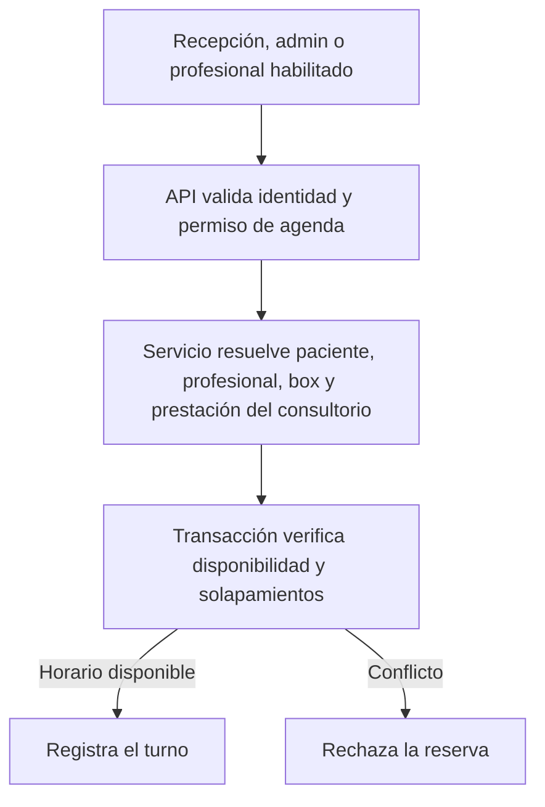

# Flujos Principales

## Autenticación y alta interna

El equipo da de alta un consultorio y su administrador por seed o comando operativo. El administrador crea los usuarios de su consultorio. El módulo `auth` verifica credenciales y expone `{ usuarioId, consultorioId, rol }`. Las rutas protegidas usan ese contexto para autorizar la operación. Cada consulta de negocio filtra por el consultorio autenticado.

## Creación de turno

Recepción o administración selecciona profesional, sillón/box, prestación, paciente y hora. Si el consultorio trabaja sin recepción, el profesional habilitado puede crear turnos en su propia agenda. El sistema obtiene la duración de la prestación, calcula el fin y guarda el intervalo `[inicio, fin)` en UTC.

Dos solicitudes simultáneas que compiten por el mismo horario no pueden confirmar ambas. Los turnos contiguos son válidos.

## Cancelación y reprogramación

El paciente avisa por teléfono o WhatsApp. Recepción registra la cancelación y el sistema conserva el turno con el estado `CANCELADO`, el usuario que operó, el origen de la solicitud (paciente o consultorio) y la fecha en UTC. El horario se libera. Administración también puede cancelar. Para reprogramar se comprueba la disponibilidad nueva con las mismas reglas de C05, excluyendo el turno que se está moviendo. Si falla, conserva el horario anterior.

## Consulta de agenda y pacientes

Recepción y administración consultan las agendas del consultorio. El profesional consulta la suya. La agenda muestra hora argentina, paciente y estado, con vistas diarias y semanales. Recepción da de alta y busca pacientes por los datos básicos de contacto.

## Ampliaciones de agenda

Confirmación, asistencia, ausencias y bloqueos se incorporan después del flujo base de turnos. Un bloqueo aprobado por el spec debe impedir reservas que crucen su intervalo. Una eventual auto-reserva puede incluir un enlace privado e impredecible para cancelar un solo turno sin cuenta, con vigencia y plazo a definir.
