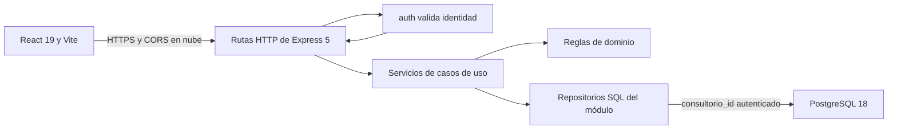

# Arquitectura Propuesta

El backend es un monolito modular en Node.js con Express 5 y JavaScript. El frontend React 19 con Vite se sirve por separado. PostgreSQL 18 usa un esquema compartido con aislamiento por consultorio.



## Capas y módulos

| Capa | Responsabilidad |
|---|---|
| Rutas | Interpretar la petición, invocar un caso de uso y traducir el resultado a HTTP. |
| Servicios | Autorizar el caso de uso, coordinar módulos y delimitar transacciones. |
| Dominio | Aplicar reglas de negocio, como duración, intervalos y cambios de estado. |
| Repositorios | Ejecutar SQL parametrizado, acotado al `consultorio_id`, sobre las tablas propias. |

Los módulos son `auth`, `consultorios`, `catalogo`, `pacientes` y `turnos`. Cada módulo expone una interfaz. Por ejemplo, turnos obtiene la duración de la prestación por catálogo. Los módulos respetan la propiedad de tablas aunque sus relaciones tengan claves foráneas.

## Identidad y aislamiento

`src/modules/auth/` concentra el login y el mecanismo de token. Expone `{ usuarioId, consultorioId, rol }`. Los módulos consumidores reciben el contexto ya validado. El cliente jamás selecciona el consultorio de operación. En repositorios, toda lectura o mutación de datos de negocio incluye el filtro de consultorio. Unicidad e índices de negocio incorporan el mismo identificador. Se prueban lecturas y escrituras cruzadas entre dos consultorios ficticios.

La decisión del mecanismo de token y su ciclo de vida se documentará al especificar C00/C01.

## Estructura prevista

```text
src/
  modules/
    auth/
    consultorios/
    catalogo/
    pacientes/
    turnos/
db/
  migrations/
frontend/
```

Las capas se implementan en archivos distintos dentro de cada módulo. La API se conecta por `DATABASE_URL`. El runner aplica SQL numerado en `db/migrations/`, con la misma secuencia local y en Neon. Los tiempos de agenda se guardan en UTC con `timestamptz`. La UI presenta `America/Argentina/Buenos_Aires`.

## Entornos

Durante el MVP se ejecuta localmente con PostgreSQL 18 mediante Compose o instalación directa de la misma versión. C10 despliega el frontend en Vercel, la API en Render y la base en Neon, con CORS limitado al origen autorizado. Los límites de los planes se verifican al desplegar. Los valores locales quedan en `.env` fuera del repositorio y `.env.example` documenta las variables sin credenciales.
