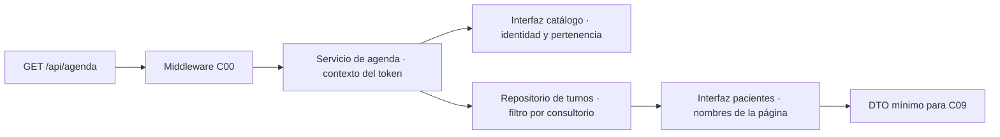

# Design

## Context

Motivación en proposal.md y comportamiento en specs/agenda/spec.md. Explore se realizó leyendo main `666dbc7`: KB 03/05/07/10, CHANGES.md, plan de ejecución, contrato C05, spec principal turnos de C07, rutas y repositorio de turnos, interfaz de catálogo y migración 050.

Hallazgos comprobados:
- C05 registra turnos en UTC; C07 ya está integrado. C06 no está integrado en esta base. La tabla ya admite CANCELADO y la consulta solo necesita leer ese estado.
- El vínculo existente de C02 es `profesional.usuario_id`. `profesionalDeUsuario({ usuarioId, consultorioId })` devuelve la ficha vinculada o null, incluidas fichas inactivas. C08 usa esa interfaz y no hace JOIN directo a profesional ni crea otra relación o migración. `existeProfesional` verifica pertenencia sin exigir actividad.
- La migración 050 ya contiene `turno_consultorio_profesional_inicio_idx`. No hace falta crear el mismo índice en 080.
- Los turnos y sus recursos están distribuidos entre módulos. C03 no ofrece lectura de nombres por un conjunto de IDs, por lo que C08 necesita una interfaz mínima de pacientes.
- Evidencia histórica: 421/421 tests en 47 archivos, iniciados el 23/11/2026 a las 16:45:58 -03:00, sobre `666dbc721c7d8046383f299689853bcf491ca50a`, antes de cambiar código. No contenía C06 ni la migración 110. Reporte original guardado en `docs/evidencias/c08/base-main.json`; corresponde a esa base y no habilita Apply sobre la versión final de C05 todavía pendiente de archivado.
- Consulta remota posterior: upstream/main `85f253d` contiene el revert de C06 mediante PR #18. `git diff 666dbc7 85f253d` no muestra cambios de archivos y la 110 está ausente. Esta observación no es una nueva ejecución de tests ni una aprobación del spec de C08.

## Goals / Non-Goals

**Goals:** contrato de lectura acotado y verificable para C09, identidad profesional desde catálogo, nombres por interfaz de pacientes y SQL de turnos con filtro obligatorio por consultorio.

**Non-Goals:** modificar las escrituras de C05/C06/C07; tocar autenticación; implementar frontend, confirmaciones, asistencia, bloqueos o nuevas transiciones; añadir dependencias.

## Decisions

### 1. Ruta propia y archivos separados

Crear `src/modules/turnos/agenda-rutas.js`, `agenda-servicios.js`, `agenda-dominio.js` y `agenda-repositorio.js`. Exportar `crearRouterAgenda()` desde su archivo de rutas. Montar `/api/agenda` con exactamente un import y un app.use en app.js, manteniendo el orden de imports de módulos y antes del manejador de errores.

El router monta middlewareAutenticacion de C00; el servicio recibe el contexto autenticado. No editar rutas.js, servicios.js ni repositorio.js de C05/C07, ni los archivos de C06. Alternativa descartada: ampliar el router compartido de turnos durante el trabajo paralelo del equipo.

### 2. Contrato propuesto para C09

```text
GET /api/agenda?desde=<ISO con zona>&hasta=<ISO con zona>
               [&profesionalId=<UUID>][&limite=100][&offset=0]
Authorization: Bearer <token>
```

Ejemplos ficticios:
- Día local: desde `2026-12-01T00:00:00-03:00`, hasta `2026-12-02T00:00:00-03:00`.
- Semana local de lunes a lunes: desde `2026-11-30T00:00:00-03:00`, hasta `2026-12-07T00:00:00-03:00`.
- C09 construye los parámetros con URLSearchParams, que codifica correctamente un offset positivo que contenga `+`.

Respuesta:

```json
{
  "desde": "2026-12-01T03:00:00.000Z",
  "hasta": "2026-12-02T03:00:00.000Z",
  "zonaHoraria": "America/Argentina/Buenos_Aires",
  "turnos": [],
  "hayMas": false,
  "siguienteOffset": null
}
```

Los campos de cada turno están enumerados en el spec; pacienteApellido puede ser null. C09 usa las interfaces de catálogo existentes para mostrar los nombres de profesional, box y prestación a partir de sus IDs. No incluir consultorioId ni contactos del paciente en el DTO.

Ejemplo ficticio completo para un stub de C09, NO obtenido de un endpoint implementado:

```json
{
  "desde": "2026-12-01T03:00:00.000Z",
  "hasta": "2026-12-02T03:00:00.000Z",
  "zonaHoraria": "America/Argentina/Buenos_Aires",
  "turnos": [
    {
      "id": "11111111-1111-4111-8111-111111111111",
      "pacienteId": "22222222-2222-4222-8222-222222222222",
      "pacienteNombre": "Ana Ficticia",
      "pacienteApellido": null,
      "profesionalId": "33333333-3333-4333-8333-333333333333",
      "sillonBoxId": "44444444-4444-4444-8444-444444444444",
      "prestacionId": "55555555-5555-4555-8555-555555555555",
      "inicio": "2026-12-01T13:00:00.000Z",
      "fin": "2026-12-01T13:30:00.000Z",
      "duracionMin": 30,
      "estado": "PENDIENTE"
    }
  ],
  "hayMas": false,
  "siguienteOffset": null
}
```

Los turnos son objetos planos. Solo pacienteNombre y pacienteApellido se enriquecen; los demás recursos permanecen como IDs. Sin apellido se devuelve exactamente null. Orden: inicio ASC, id ASC. Paginación: limite por defecto 100, máximo 200; offset por defecto 0, máximo 10000. Si hayMas es true, C09 repite la consulta con siguienteOffset.

Tabla de errores propuesta para agenda (aún sin implementación):

| HTTP | code | Significado |
|---|---|---|
| 400 | VALIDACION | Fechas o parámetros inválidos; rango vacío, invertido o mayor a 168 horas; paginación o UUID inválidos. |
| 401 | TOKEN_INVALIDO | Token ausente, inválido o expirado; mensaje uniforme de C00. |
| 403 | SIN_PERMISO | Odontólogo sin vínculo o que solicita otra agenda. |
| 404 | PROFESIONAL_NO_ENCONTRADO | Filtro de recepción/admin que no pertenece a su consultorio o no existe; misma señal en ambos casos. |
| 500 | ERROR_INTERNO | Fallo inesperado con mensaje seguro del manejador central. |

Todos los errores usan `{ "error": { "code": "...", "message": "..." } }`. El texto del mensaje debe servir para informar al usuario; C09 decide el comportamiento mediante status y code. Token inválido mantiene exactamente el mensaje `No autorizado` de C00.

La API recibe instantes explícitos y no calcula el calendario del cliente. C09 define los límites de su día o semana local y muestra las horas mediante Intl y la zona informada. Así no se depende de la zona horaria del servidor ni se añade una librería de fechas. Se acepta cualquier rango positivo de hasta 168 horas; los ejemplos diarios/semanales son convenciones de presentación, no validaciones de medianoche.

### 3. Validación estricta y permisos

Reutilizar validarUuid de turnos y, si su contrato encaja, su validador de instante. La validación del nuevo dominio debe rechazar normalizaciones permisivas de Date, como 30 de febrero, además de NaN, ausencia de zona, arrays y parámetros duplicados. Las validaciones adicionales permanecen en archivos C08; no cambiar el comportamiento de C05/C07.

Flujo: autenticación 401 → forma 400 → rol/vínculo 403 → filtro profesional administrativo 404 → consulta. Req.query solo admite los cinco parámetros del spec; GET no consume body ni identidad enviada en encabezados.

- ADMIN_CONSULTORIO y RECEPCION: sin filtro leen las agendas de su consultorio; con filtro comprueban pertenencia mediante existeProfesional. No exigir activo para leer historia de turnos.
- ODONTOLOGO: resolver profesionalDeUsuario con req.auth.usuarioId y req.auth.consultorioId. Sin vínculo, 403. Un profesionalId explícito distinto al vinculado da 403 sin buscar el solicitado; si coincide o no se envía, filtrar por la ficha vinculada.

La decisión se deriva de KB 03 y RN-AG-03; el usuario administrativo vinculado a un profesional conserva su permiso amplio. No cambiar JWT ni C01.

### 4. Consulta de turnos y paginación

SQL parametrizado sobre la tabla turno únicamente:

```sql
WHERE consultorio_id = $1
  AND inicio < $3 AND fin > $2
```

`$2` es desde y `$3` es hasta. Cuando hay profesional efectivo, añadir una variante SQL constante con `AND profesional_id = $4`; no usar valores interpolados ni un OR opcional que dificulte el índice. Ordenar por inicio, id. Leer limite + 1 filas, recortar la fila adicional y calcular hayMas y siguienteOffset. Usar LIMIT y OFFSET como parámetros.

Incluir todos los estados, también CANCELADO. La lectura no evalúa disponibilidad y no debe confundir cancelación con borrado. Un turno que cruza medianoche aparece en ambos días que intersecta. La semana lo devuelve una vez.

Alternativa descartada: paginar por todos los turnos en memoria o devolver una lista limitada sin advertir que hay más. Offset es suficiente para el MVP; se documenta que las escrituras concurrentes entre páginas pueden desplazar resultados. No se promete un snapshot entre solicitudes. Llegar al máximo de offset obliga a reducir el rango o filtrar profesional.

### 5. Nombres por interfaz del módulo pacientes

Proponer esta interfaz pública, sin endpoint HTTP nuevo:

```js
obtenerNombresPacientes({ pacienteIds, consultorioId })
// Promise<Array<{ id: string, nombre: string, apellido: string | null }>>
```

Implementarla en archivos propios `src/modules/pacientes/agenda-lectura.js` y `agenda-repositorio.js`, exportada desde index.js. Validar UUID, deduplicar IDs y limitar a 200 IDs por llamada, pues provienen de una página autorizada. Un array vacío devuelve [] sin consulta; IDs inexistentes o ajenos se omiten. La consulta de pacientes filtra por consultorio_id e IDs parametrizados (`ANY(...::uuid[])`).

El servicio de agenda la invoca solo después de obtener la página autorizada y combina nombres por ID sin N+1. No hacer JOIN a paciente desde SQL de turnos. La FK debería garantizar el paciente; si falta un nombre en un turno autorizado, fallar con un error inesperado seguro 500, sin devolver una agenda parcial ni intentar consultas sin consultorio. La interfaz existente existePaciente se conserva.



### 6. Verificación y propiedad

Tests propios en `tests/agenda-ruta.test.js`, `agenda-aislamiento.test.js`, `agenda-permisos.test.js`, `agenda-paginacion.test.js` y `pacientes-agenda-lectura.test.js`; fixtures propios en `tests/fixtures/agenda.js`. Las validaciones puras se ejercitan por la interfaz HTTP pública. Se reutilizan helpers existentes por import, nunca editados. Dos consultorios y dos profesionales del mismo consultorio prueban ambas fronteras, con UUID ficticios y limpieza por identificador.

Cubrir cada escenario del spec mediante dominio y HTTP real con PostgreSQL. Mantener salida roja genuina y verde de los tests nuevos. La suite completa de main puede aumentar durante el trabajo: no fijar como expectativa que siempre sean 421 tests. Antes de Apply actualizar desde main y verificar la base completa; al cerrar ejecutar npm test y strict validation, registrar fecha, número real y commits.

El RED de aislamiento se ejecuta recién después de la aprobación: dos consultorios persistidos, datos ficticios y tokens válidos hacen GET /api/agenda esperando 200; el endpoint aún inexistente responde 404. No provocar un fallo artificial ni implementar la consulta antes de registrar ese RED. Después implementar y conservar GREEN.

## Risks / Trade-offs

- Lecturas cruzadas → token como única fuente de contexto, filtro en cada repositorio y tests con nombres ajenos distinguibles.
- Conflictos con C06/C07 → archivos C08 separados, dos líneas en app.js y ninguna modificación a sus migraciones o helpers.
- Consulta por intervalos que cruzan el límite → predicado de intersección [) y pruebas exactas de extremos.
- Nombres históricos cambian si se edita una ficha → el DTO muestra el nombre actual; no se añade snapshot de pacientes al turno.
- Offset durante cambios concurrentes → limitación documentada; refrescar la vista y no prometer una instantánea entre páginas.
- Índice sin profesional menos selectivo → rango máximo de siete días y páginas acotadas; evaluar EXPLAIN y comunicar una necesidad demostrada al responsable del esquema, sin añadir DDL a turno en C08.

## Migration Plan

No se requiere migración de esquema. C08 no crea migraciones ni modifica la estructura de turno, sus índices o restricciones. Se reutilizan índices de 050; no alterar 050 ni 070. El rango reservado 080–089 queda sin usar. Cualquier necesidad de esquema se comunica a Agustina y requiere revisar el alcance; no habilita escribir una migración ni usar el prefijo 110 por cuenta propia. El retiro de la funcionalidad sería revertir archivos C08 y sus dos líneas de montaje, sin modificar datos.

## UI Mockups

Decision: no (no UI). C08 entrega API; la interfaz visual pertenece a C09.

## Estado de revisión

Contrato aprobado por Agustina mediante PR #22. Apply autorizado expresamente el 24/11/2026 tras ver el RED genuino de aislamiento y la suite base. Se implementa en una única sesión y rama, con git status antes de cada escritura y sin alterar aserciones para conseguir GREEN.

Base previa: `5e0f581846c241bd25c5e242ac881be81264bb44`, suite 458/458 tests en 49 archivos. Después se incorporó por fast-forward `7dcdcd1304bec09079206cacb8731ce9627ee466`, que solo añade los cuatro Markdown aprobados de PR #22. C05 está archivado en `2026-11-24-c05-crear-turno-sin-solapamientos`; migración C06 071, sin 110. La suite completa se vuelve a ejecutar al cerrar sobre la implementación resultante.

## Evidencia por tandas

Todos los logs originales y reportes JSON se conservan en docs/evidencias/c08. El test inicial de aislamiento mantiene SHA256 `51FCD35819CF277D58C0BE6E3055D6AAE959F9D94981C2D8140C38BECE08D7A7`.

| Tanda | RED original | GREEN acumulado |
|---|---|---|
| Ruta, parámetros y lectura mínima | tanda1-red-valido: 24 fallos, 3 aprobados; ruta ausente y export de nombres aún inexistente | tanda1-green: 27/27 |
| Filtro por rol y profesional | tanda2-red: 4 fallos, 5 aprobados; filtro ignorado y odontólogo propio rechazado | tanda2-green: 36/36 |
| Paginación | tanda3-red: 2 fallos, 9 aprobados; límite/offset no aplicados | tanda3-green: 47/47 |

Se conserva también tanda1-red como diagnóstico inicial: contenía un error de fixture al pedir dos veces recursos con el mismo nombre profesional. Se quitó un crearRecursos innecesario del test nuevo, sin tocar aserciones, y se repitió el RED válido antes de escribir código productivo. No se reemplazaron ni maquillaron las salidas originales.

Los 47 tests cubren rango diario/semanal, intersección y medianoche, cancelados y reprogramados, estados inactivos, roles, pacienteApellido null, pertenencia, suplantación por query/body/headers, paginación, limpieza independiente y error inesperado de la interfaz de pacientes. Esta última se sustituye solo en la frontera entre módulos para simular fallo; SQL y HTTP de integración son reales.

## Verify final

Suite completa el 24/11/2026, inicio 20:10:35 -03:00: **505/505 tests en 54 archivos**, cero fallos, 118.02 segundos. Base integrada `7dcdcd1304bec09079206cacb8731ce9627ee466`, implementación aún sin commit durante esa primera ejecución (según la condición de commitear después del GREEN). Reportes originales suite-completa-green.txt y suite-completa-green.json. El SHA del commit de implementación y su comprobación posterior se entregan en el PR de cierre.

Validación estricta OpenSpec y git diff --check aprobados. Revisión de SQL: parámetros para todos los valores, predicado temporal [) sin funciones sobre columnas, filtro por consultorio en las dos lecturas, variante por profesional sin JOIN a catálogo ni pacientes. `src/app.js` agrega exactamente dos líneas. package.json, package-lock.json, tests/setup, helpers y db/migrations coinciden con la base integrada. No hay nuevas dependencias ni migraciones.

Los archivos de evidencia histórica conservan el estado de su momento, incluido preparacion-red.md que indica que Apply aún no estaba autorizado. El presente apartado documenta la autorización y verificación posteriores; no se alteran los logs históricos.

Limitaciones acordadas: nombres actuales del paciente (sin snapshot histórico), rango de hasta 168 horas y paginación offset sin snapshot entre solicitudes concurrentes. No se agrega UI, confirmación, asistencia ni bloqueos. Archive queda después de la revisión correspondiente; no se cierran changes ajenos.
