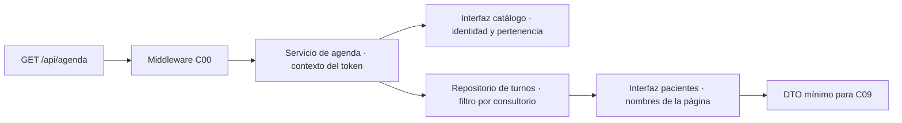

# Design

## Context

Motivación en proposal.md y comportamiento en specs/agenda/spec.md. Explore se realizó leyendo main `666dbc7`: KB 03/05/07/10, CHANGES.md, plan de ejecución, contrato C05, spec principal turnos de C07, rutas y repositorio de turnos, interfaz de catálogo y migración 050.

Hallazgos comprobados:
- C05 registra turnos en UTC; C07 ya está integrado. C06 no está integrado en esta base. La tabla ya admite CANCELADO y la consulta solo necesita leer ese estado.
- `profesionalDeUsuario({ usuarioId, consultorioId })` devuelve la ficha vinculada o null, incluidas fichas inactivas. `existeProfesional` verifica pertenencia sin exigir actividad.
- La migración 050 ya contiene `turno_consultorio_profesional_inicio_idx`. No hace falta crear el mismo índice en 080.
- Los turnos y sus recursos están distribuidos entre módulos. C03 no ofrece lectura de nombres por un conjunto de IDs, por lo que C08 necesita una interfaz mínima de pacientes.
- Base local comprobada el 23/11/2026: 421/421 tests aprobados, antes de cambiar código. Reporte original guardado en `docs/evidencias/c08/base-main.json`; corresponde a la base, no a una implementación de C08.

## Goals / Non-Goals

**Goals:** contrato de lectura acotado y verificable para C09, identidad profesional desde catálogo, nombres por interfaz de pacientes y SQL de turnos con filtro obligatorio por consultorio.

**Non-Goals:** modificar las escrituras de C05/C06/C07; tocar autenticación; implementar frontend, confirmaciones, asistencia, bloqueos o nuevas transiciones; añadir dependencias.

## Decisions

### 1. Ruta propia y archivos separados

Crear `src/modules/turnos/agenda-rutas.js`, `agenda-servicios.js`, `agenda-dominio.js` y `agenda-repositorio.js`. Exportar `crearRouterAgenda()` desde su archivo de rutas. Montar `/api/agenda` con exactamente un import y un app.use en app.js, manteniendo el orden de imports de módulos y antes del manejador de errores.

El router monta middlewareAutenticacion de C00; el servicio recibe el contexto autenticado. No editar rutas.js, servicios.js ni repositorio.js de C05/C07, ni los archivos de C06. Alternativa descartada: ampliar el router compartido de turnos durante el trabajo paralelo del equipo.

### 2. Contrato propuesto para C09

```text
GET /api/agenda?desde=<ISO con zona>&hasta=<ISO con zona>
               [&profesionalId=<UUID>][&limite=100][&offset=0]
Authorization: Bearer <token>
```

Ejemplos ficticios:
- Día local: desde `2026-12-01T00:00:00-03:00`, hasta `2026-12-02T00:00:00-03:00`.
- Semana local de lunes a lunes: desde `2026-11-30T00:00:00-03:00`, hasta `2026-12-07T00:00:00-03:00`.
- C09 construye los parámetros con URLSearchParams, que codifica correctamente un offset positivo que contenga `+`.

Respuesta:

```json
{
  "desde": "2026-12-01T03:00:00.000Z",
  "hasta": "2026-12-02T03:00:00.000Z",
  "zonaHoraria": "America/Argentina/Buenos_Aires",
  "turnos": [],
  "hayMas": false,
  "siguienteOffset": null
}
```

Los campos de cada turno están enumerados en el spec; pacienteApellido puede ser null. C09 usa las interfaces de catálogo existentes para mostrar los nombres de profesional, box y prestación a partir de sus IDs. No incluir consultorioId ni contactos del paciente en el DTO.

La API recibe instantes explícitos y no calcula el calendario del cliente. C09 define los límites de su día o semana local y muestra las horas mediante Intl y la zona informada. Así no se depende de la zona horaria del servidor ni se añade una librería de fechas. Se acepta cualquier rango positivo de hasta 168 horas; los ejemplos diarios/semanales son convenciones de presentación, no validaciones de medianoche.

### 3. Validación estricta y permisos

Reutilizar validarUuid de turnos y, si su contrato encaja, su validador de instante. La validación del nuevo dominio debe rechazar normalizaciones permisivas de Date, como 30 de febrero, además de NaN, ausencia de zona, arrays y parámetros duplicados. Las validaciones adicionales permanecen en archivos C08; no cambiar el comportamiento de C05/C07.

Flujo: autenticación 401 → forma 400 → rol/vínculo 403 → filtro profesional administrativo 404 → consulta. Req.query solo admite los cinco parámetros del spec; GET no consume body ni identidad enviada en encabezados.

- ADMIN_CONSULTORIO y RECEPCION: sin filtro leen las agendas de su consultorio; con filtro comprueban pertenencia mediante existeProfesional. No exigir activo para leer historia de turnos.
- ODONTOLOGO: resolver profesionalDeUsuario con req.auth.usuarioId y req.auth.consultorioId. Sin vínculo, 403. Un profesionalId explícito distinto al vinculado da 403 sin buscar el solicitado; si coincide o no se envía, filtrar por la ficha vinculada.

La decisión se deriva de KB 03 y RN-AG-03; el usuario administrativo vinculado a un profesional conserva su permiso amplio. No cambiar JWT ni C01.

### 4. Consulta de turnos y paginación

SQL parametrizado sobre la tabla turno únicamente:

```sql
WHERE consultorio_id = $1
  AND inicio < $3 AND fin > $2
```

`$2` es desde y `$3` es hasta. Cuando hay profesional efectivo, añadir una variante SQL constante con `AND profesional_id = $4`; no usar valores interpolados ni un OR opcional que dificulte el índice. Ordenar por inicio, id. Leer limite + 1 filas, recortar la fila adicional y calcular hayMas y siguienteOffset. Usar LIMIT y OFFSET como parámetros.

Incluir todos los estados, también CANCELADO. La lectura no evalúa disponibilidad y no debe confundir cancelación con borrado. Un turno que cruza medianoche aparece en ambos días que intersecta. La semana lo devuelve una vez.

Alternativa descartada: paginar por todos los turnos en memoria o devolver una lista limitada sin advertir que hay más. Offset es suficiente para el MVP; se documenta que las escrituras concurrentes entre páginas pueden desplazar resultados. No se promete un snapshot entre solicitudes. Llegar al máximo de offset obliga a reducir el rango o filtrar profesional.

### 5. Nombres por interfaz del módulo pacientes

Proponer esta interfaz pública, sin endpoint HTTP nuevo:

```js
obtenerNombresPacientes({ pacienteIds, consultorioId })
// Promise<Array<{ id: string, nombre: string, apellido: string | null }>>
```

Implementarla en archivos propios `src/modules/pacientes/agenda-lectura.js` y `agenda-repositorio.js`, exportada desde index.js. Validar UUID, deduplicar IDs y limitar a 200 IDs por llamada, pues provienen de una página autorizada. Un array vacío devuelve [] sin consulta; IDs inexistentes o ajenos se omiten. La consulta de pacientes filtra por consultorio_id e IDs parametrizados (`ANY(...::uuid[])`).

El servicio de agenda la invoca solo después de obtener la página autorizada y combina nombres por ID sin N+1. No hacer JOIN a paciente desde SQL de turnos. La FK debería garantizar el paciente; si falta un nombre en un turno autorizado, fallar con un error inesperado seguro 500, sin devolver una agenda parcial ni intentar consultas sin consultorio. La interfaz existente existePaciente se conserva.



### 6. Verificación y propiedad

Tests propios en `tests/agenda-dominio.test.js`, `agenda-api.test.js` y `pacientes-agenda-lectura.test.js`; fixtures propios en `tests/fixtures/agenda.js`. Pueden reutilizar helpers existentes por import, nunca editarlos. Crear dos consultorios y dos profesionales del mismo consultorio para probar ambas fronteras. UUID ficticios por fixture, limpieza por IDs propios y rollback cuando corresponda.

Cubrir cada escenario del spec mediante dominio y HTTP real con PostgreSQL. Mantener salida roja genuina y verde de los tests nuevos. La suite completa de main puede aumentar durante el trabajo: no fijar como expectativa que siempre sean 421 tests. Antes de Apply actualizar desde main y verificar la base completa; al cerrar ejecutar npm test y strict validation, registrar fecha, número real y commits.

## Risks / Trade-offs

- Lecturas cruzadas → token como única fuente de contexto, filtro en cada repositorio y tests con nombres ajenos distinguibles.
- Conflictos con C06/C07 → archivos C08 separados, dos líneas en app.js y ninguna modificación a sus migraciones o helpers.
- Consulta por intervalos que cruzan el límite → predicado de intersección [) y pruebas exactas de extremos.
- Nombres históricos cambian si se edita una ficha → el DTO muestra el nombre actual; no se añade snapshot de pacientes al turno.
- Offset durante cambios concurrentes → limitación documentada; refrescar la vista y no prometer una instantánea entre páginas.
- Índice sin profesional menos selectivo → rango máximo de siete días y páginas acotadas; evaluar EXPLAIN antes de proponer otra migración, sin optimización especulativa.

## Migration Plan

No se requiere migración de esquema. Se reutilizan índices de 050; no alterar 050 ni 070. Si una medición demuestra necesario otro índice, volver a la propuesta, usar un prefijo nuevo en 080–089 y obtener aprobación antes de escribirlo. El retiro de la funcionalidad sería revertir archivos C08 y sus dos líneas de montaje, sin modificar datos.

## UI Mockups

Decision: no (no UI). C08 entrega API; la interfaz visual pertenece a C09.

## Estado de revisión

Propuesta pendiente de aprobación. No se ha iniciado Apply. Las decisiones de endpoint, parámetros, inclusión de cancelados, paginación y DTO se presentan para revisión; no constituyen un contrato aprobado ni se comunican como congeladas hasta que Agustina lo confirme.
